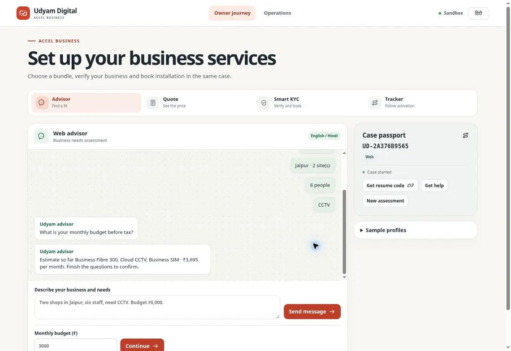
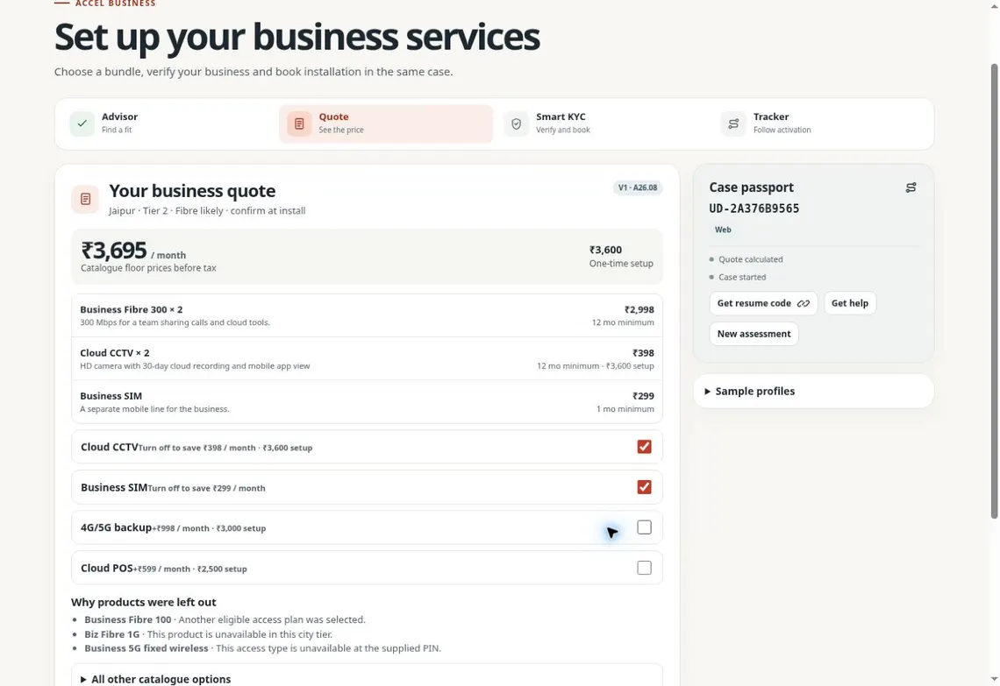
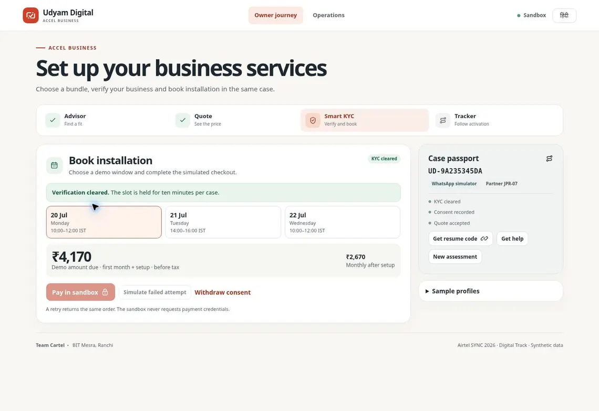
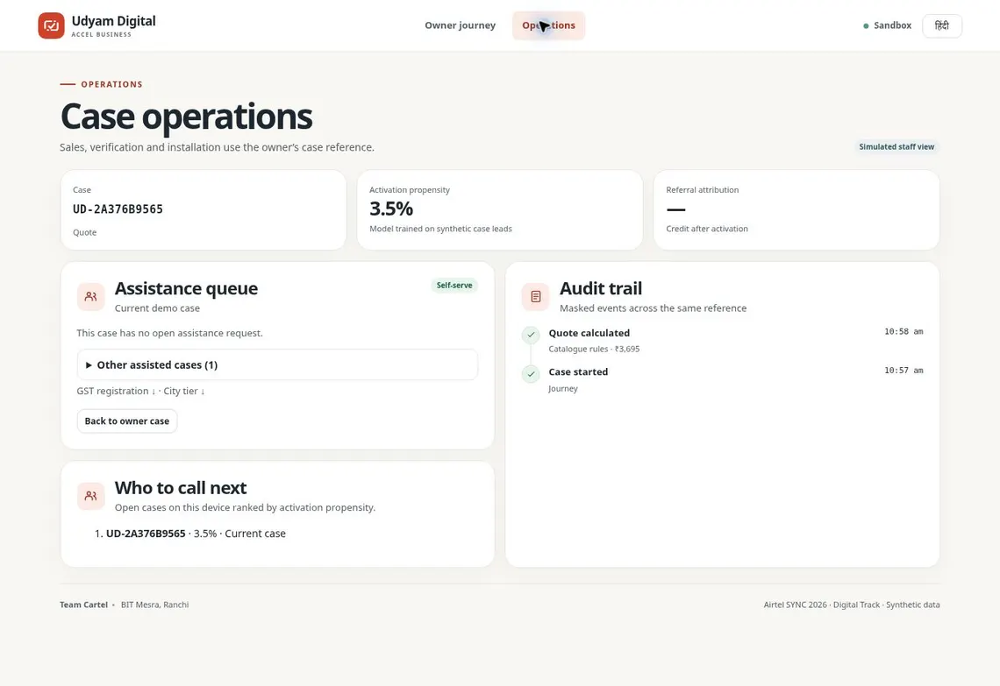

# Udyam Digital

Team Cartel · BIT Mesra, Ranchi  
Airtel SYNC 2026 Digital Track · Accel Business

A bilingual sandbox where a small business can describe its needs, compare an itemized bundle, verify synthetic proofs, book an installation and track activation under one case reference.

## Run locally

Use Node.js 22.13 or newer.

```sh
npm ci
npm start
```

Open <http://localhost:4173>. The install step prepares self-hosted browser OCR. The default flow needs no model key. Local cases use SQLite under `.udyam/`. Run `npm test` for the portable suite and `npm run build` for the Worker bundle.

## Brief to prototype

| Requirement | Implemented feature |
| --- | --- |
| Conversational GenAI advisor | English and Hindi free text, optional OpenAI, Gemini or Anthropic profile extraction, deterministic text parsing and a six-step guided form. |
| Catalogue fit and clear price | All 25 products, PIN and city-tier inference, per-site access and failover, GST and product eligibility, budget trimming and an explanation for each excluded SKU. |
| Transparent checkout | Monthly and setup totals, terms, eligible add-on toggles, revision checks, a slot hold and retry-safe sandbox payment. |
| Smart KYC | Consent, device-local OCR, de-skew and blur detection, server-side registry and cross-document checks, correction and review. |
| Tracker | Shared case reference, per-product installation and activation status, and one partner credit at full activation. |
| WhatsApp and web handoff | Signed Cloud API webhook that drives the advisor and replies with a 10-minute single-use web link. The web demo also supports a manual resume code. |
| Field force and local partners | Sales and verification queues, same-case referral context and a “Who to call next” ranking in Operations. |
| Business case and pilot measures | The separate business deck covers segment selection, bundles and rollout. Pilot model and targets are listed below. |
| Submission evidence | Architecture, privacy note and test tables are linked below. The demo video and business deck are separate submission artifacts. |

## Walkthrough

| Workflow | Steps |
| --- | --- |
| Free text | Send `मेरी जयपुर में दो दुकानें हैं, 6 लोग, CCTV चाहिए`. Finish with `₹4,000 per month, no GSTIN` to see a two-site estimate of ₹3,695/month and ₹3,600 setup. |
| Quote | Open **Sample profiles → Clinic with fibre**. Turn off 4G/5G backup to change ₹2,670/month and ₹1,500 setup to ₹2,171/month and ₹0 setup. |
| Smart KYC | Accept the quote, consent and scan the clinic proofs. The cancelled-GSTIN sample demonstrates the review hold. The Operations desk can return a reviewed case for correction. |
| Checkout and tracker | In the cleared clinic case, hold a slot and use sandbox payment. Post installation and product milestones in **Operations** and reopen the owner tracker. |
| Field assistance | Use a known PIN outside coverage or a budget well below the minimum access cost. Multi-site and factory cases can receive an itemized quote directly. |









## Organizer data

The full organizer files are kept out of GitHub to limit redistribution of case records and proof images. Judges with the contestant dataset can import their extracted copy locally.

```sh
python -m pip install Pillow
python scripts/import-case.py /path/to/extracted/organizer-data
CASE_DATA_DIR=/path/to/extracted/organizer-data npm test
npm start
```

Point the importer at the directory containing the catalogue, leads, both mock registries and `kyc_documents/`. It generates ignored local data and specimen assets, and retrains the scoring model. The 12 original cases then appear under **Sample profiles**. The public checkout ships the catalogue terms, aggregate model coefficients and fictional starter proofs. KYC uses the case clock of 15 July 2026.

## Optional integrations

Configure server-side values in the hosting environment or copy [.env.example](.env.example) to `.env` and run `node --env-file=.env scripts/serve.mjs` locally.

- **Model configuration.** Set `ADVISOR_PROVIDER` and one of `OPENAI_API_KEY`, `GEMINI_API_KEY` or `ANTHROPIC_API_KEY`. The matching `*_MODEL` setting is optional. Eligibility and prices come from the catalogue. Hosted explanations containing numbers or currency fall back to the rules copy.
- **WhatsApp configuration.** Set the five `WHATSAPP_*` values and `PUBLIC_APP_URL`. Apply both migrations on the host. Register an externally reachable HTTPS `/api/whatsapp/webhook` with Meta and subscribe the app to `messages`. The web handoff points to `PUBLIC_APP_URL`. Local tests exercise the protocol with a simulated Graph transport.

## Results

See the [KYC and advisor test tables](docs/test-results.md), [architecture diagram](docs/architecture.md) and [one-page privacy and security note](docs/privacy-security.md). The activation model was fit on 4,000 supplied leads and measured on the last 1,000. Holdout AUC was **0.6484** and Brier score was **0.0649**. The queue uses the estimate as an ordering signal.

| Pilot measure | Synthetic baseline | Business-deck scenario or target |
| --- | ---: | ---: |
| Lead-to-activation | 7.36% | 12.2% modelled |
| Acquisition cost per activation | ₹15.1k | ₹9.8k modelled |
| Mean time to activate | 17.6 days | ≤9 days |
| Follow-up calls per activation | 3.0 | ≤1 |
| Six-month churn | 15.2% | ≤13% |

The pilot numbers are projections and goals. Prototype test results measure workflow behavior.
