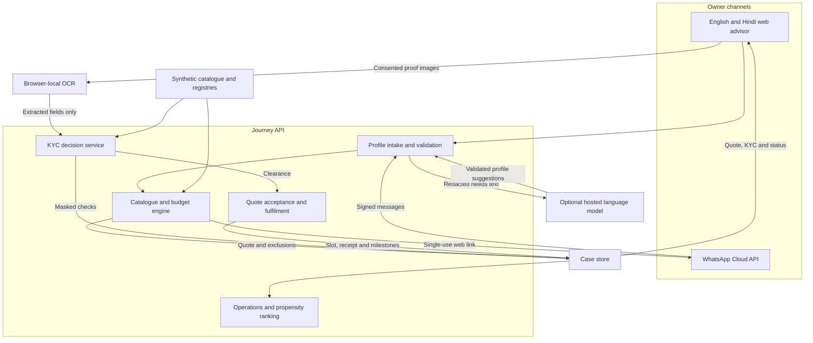

# Solution architecture

The web advisor and the WhatsApp webhook share one server-side case and one catalogue engine. A one-time handoff continues that case on the web through verification, checkout and activation.

| Component | Responsibility |
| --- | --- |
| Browser | Guided intake, free text, quote toggles, consent, document preparation and Tesseract WASM. |
| Intake | English and Hindi keyword parsing works offline. Optional OpenAI, Gemini or Anthropic extraction supplies typed suggestions. The server validates the schema and checks GSTIN separately. |
| Quote engine | All 25 catalogue items, city-tier and PIN inference, eligibility, quantities, budget trimming and per-product exclusion reasons. Unknown serviceability is provisional. |
| KYC service | Checksum, registry status, legal/trade names, current address and signatory checks. Returns correction, manual review or clearance with masked references. |
| Journey store | SQLite locally and D1 in a Worker. Optimistic revisions protect quote and checkout state. The resume code has a 10-minute expiry and rotates the bearer when redeemed. |
| Fulfilment | Sandbox slot holds, payment retries and per-product activation milestones. Partner credit posts once when the order is fully active. |
| Operations | Same-case assistance and audit trail, plus a logistic regression rank for open cases available on this device. |
| WhatsApp adapter | Verifies Meta callbacks, deduplicates message deliveries and sends the advisor’s next question or quote link. |

Fibre 100 starts at one staff member and Fibre 300 is preferred at three. Tier-one fibre moves to gigabit at five staff with active GSTIN. Leased lines become eligible at ten and 25 staff with active GSTIN. Every pick passes its CSV eligibility and dependency rules. If the total is above budget, the engine drops optional items, steps down the access plan, and restores requested items that now fit. It offers field sales if the remaining gap exceeds the greater of ₹1,000 or 35% of budget.
